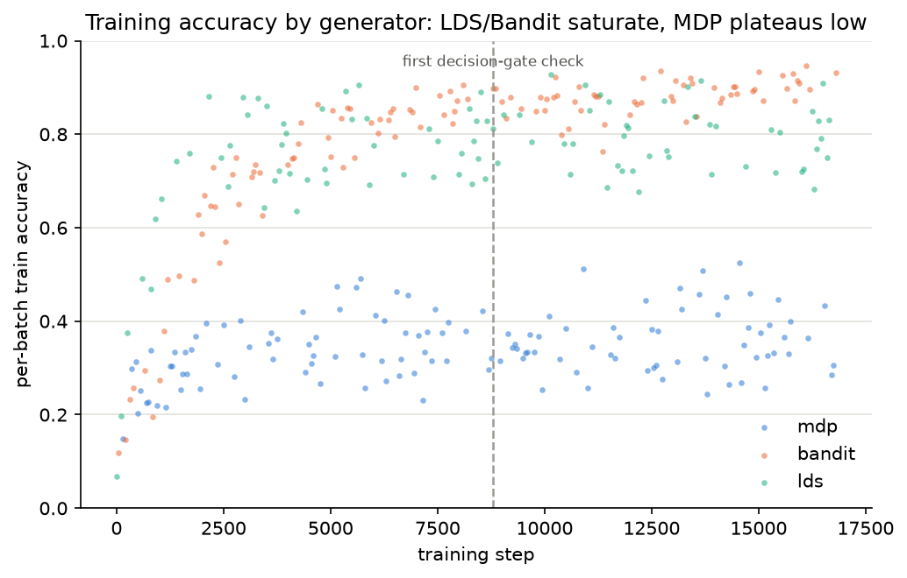
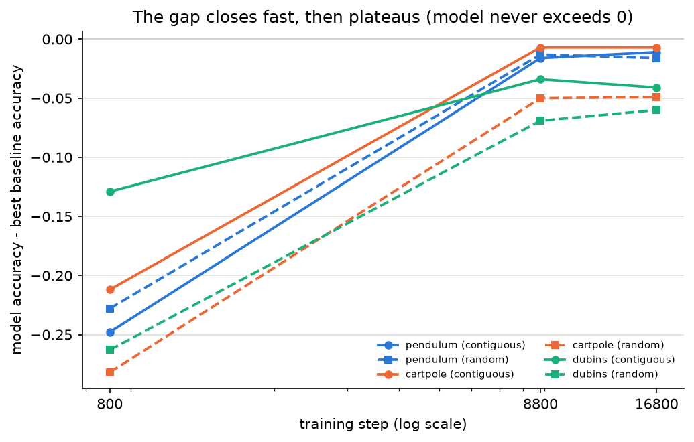
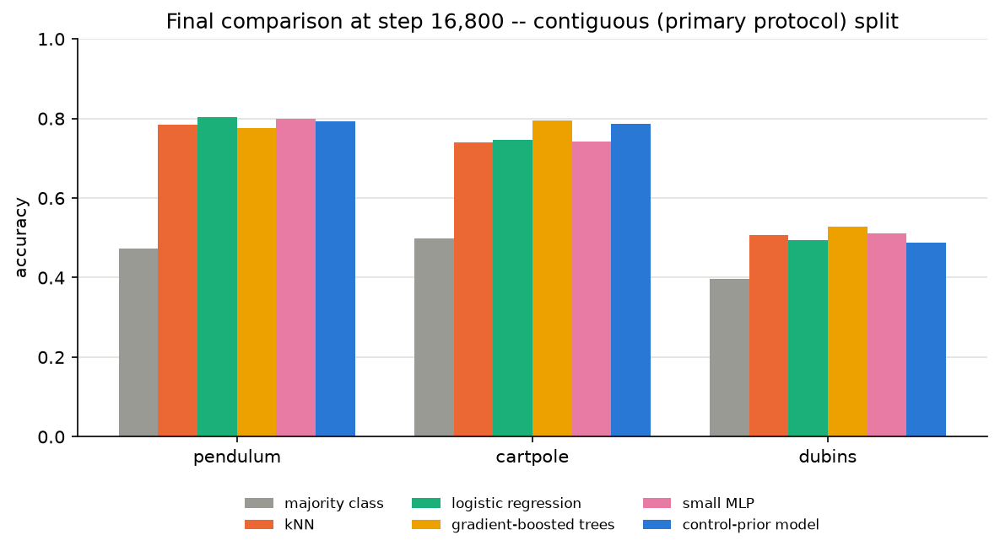
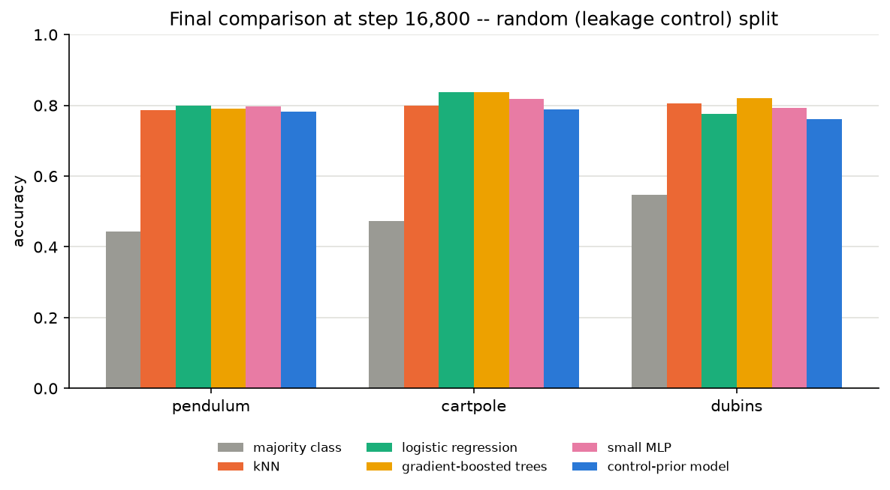
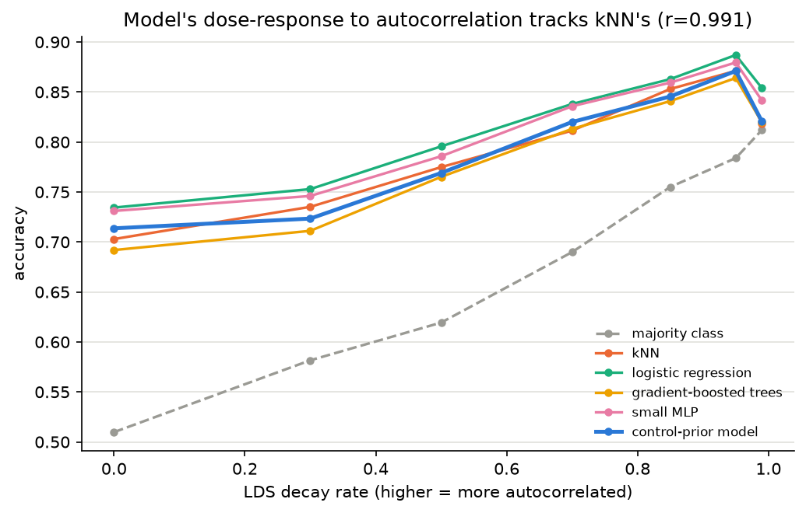
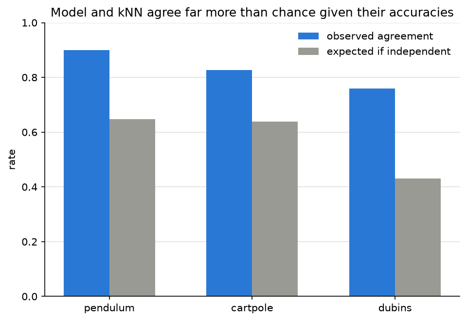
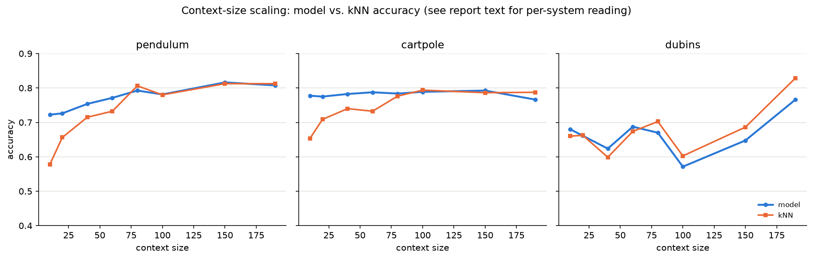

# Does Control-Prior Pretraining Learn Control, or Local Smoothing?

**An independent, simulation-only replication study of "Learning Robot Behavior Priors from Non-Robotic Synthetic Data" (arXiv 2610.31275)**

Status: Phases 0–2 complete. All code, data, and results referenced here are in this repository; nothing in this report depends on information outside it.

## Abstract

A recent preprint claims that a small transformer pretrained only on procedurally generated, non-robotic synthetic data (random MDPs, contextual bandits, linear dynamical systems) can predict robot actions above chance on real datasets it never saw, via in-context learning. The paper never tests against a single simple baseline. We reimplement its three generators from their written description, build a baseline suite (majority class, kNN, logistic regression, gradient-boosted trees, small MLP), and pretrain a from-scratch model at a laptop-feasible scale to test whether the effect survives against those baselines, and if so, what mechanism explains it. At this scale, it does not survive: the model approaches but never exceeds strong simple baselines, and the gap plateaus rather than closing with more training. A direct manipulation of the one generator property the paper's own ablation flags as most important — temporal autocorrelation — shows the model's behavior tracking a kNN baseline's almost exactly (r=0.991) across the full range tested. Four further mechanism probes are consistent with a single story: the model has learned something closer to a Bayesian-smoothed local-structure prior than to long-horizon control reasoning, with one genuine, narrower benefit — a sample-efficiency edge at small context sizes that vanishes as context grows.

## 1. Motivation

[docs/00_critique_and_plan.md](00_critique_and_plan.md) has the full critique; the short version: arXiv 2610.31275's own internal evidence already points toward a skeptical reading of its central claim. Its own ablation (its Section V-C) shows the LDS generator — pure smooth, autocorrelated dynamics, no notion of reward or long-horizon value — alone matches the full three-generator mixture, while the MDP generator (long-horizon value structure) underperforms even a generic, non-robotic tabular prior on some metrics. The paper attributes this to "local temporal continuity... rather than long-horizon value structure," but never tests that explanation against the obvious control: a model that implements local temporal continuity directly, i.e. a k-nearest-neighbors classifier. This gap is Research Question 1, and the reason we built the baseline suite before anything else.

## 2. Method

### 2.1 Simulated systems (evaluation targets)

Three known-expert systems with randomized physical parameters and closed-form oracle accuracy ceilings, described in [src/synctrl/sims/](../src/synctrl/sims/): a pendulum swing-up/balance task (energy-shaping + PD control, 3 discrete torque actions), a cartpole balance task (PD bang-bang, 2 discrete force actions), and a Dubins-car goal-pursuit task (proportional heading control, 3 discrete steering actions). All simulation; no real-robot data of any kind is used or claimed anywhere in this project.

### 2.2 Synthetic control-prior generators (pretraining data)

Reimplemented from the paper's Section IV-B description — no code or checkpoints are released yet — in [src/synctrl/generators/](../src/synctrl/generators/). Every detail the paper doesn't specify (RFF feature counts, value-iteration horizon, decay-rate range, etc.) is logged in [docs/reimplementation-assumptions.md](reimplementation-assumptions.md) rather than silently assumed:

- **MDP**: tabular Markov decision process, states in a random subset of $[0,1]^d$, reward and transition dynamics jointly sampled from a random-Fourier-feature GP, solved via truncated value iteration, rolled out under a Boltzmann policy.
- **Contextual Bandit**: single-step, state-conditioned action selection via a random bilinear reward over RFF embeddings of state and action features; no temporal structure.
- **LDS**: linear dynamics $x_{t+1} = Ax_t + b_a + \varepsilon$ with decay rates near 1 (high autocorrelation), rolled out under a random linear-softmax policy.

All three follow the TabPFN seq-first `get_batch(batch_size, seq_len, num_features, ...)` convention (verified directly against the installed `tabpfn==0.1.11` package in [docs/data-contract-tabpfn.md](data-contract-tabpfn.md)), with shared feature padding/permutation and z-scoring, matching the paper's own preprocessing description.

### 2.3 Model

A `tabpfn.transformer.TransformerModel` instance (the exact architecture class the paper reuses), sized for laptop-feasible training: 64-dim embeddings, 4 heads, 128-dim feedforward, 4 layers — far smaller than the paper's 256-dim/4-head/12-layer configuration (confirmed from the library's own default config in Phase 0). Pretrained on a uniform mixture of the three generators above (the paper's "Control Priors" configuration; the generic tabular-prior ablation was wired up in [src/synctrl/generators/tabular_prior.py](../src/synctrl/generators/tabular_prior.py) but not used in the main comparison, since Phase 0 found its full SCM/BNN/GP hyperparameter-resolution path doesn't work out of the box in this tabpfn install).

Training budget: 16,800 steps, batch size 16, sequence length 200 (100 context / 100 query), ~4.3 hours total on a single laptop GPU (GTX 1650). For comparison, the paper trains for ~30 hours per model on 15 million synthetic datasets — this project's training is roughly three orders of magnitude smaller.

### 2.4 Baselines

Five baselines, each fit fresh per task on the context alone with no state carried between tasks ([src/synctrl/baselines/](../src/synctrl/baselines/)): majority class, k-nearest-neighbors (k=5), multinomial logistic regression, gradient-boosted trees, and a small MLP. This is exactly the comparison the original paper never runs.

### 2.5 Evaluation protocol

Tasks are built from simulator rollouts (or, for RQ2, directly from a generator), split into context and query either **contiguously** (context = first half in time, query = second half — the realistic, primary protocol) or **randomly** (all timesteps shuffled before splitting — a deliberate leakage control: if a method does much better under random splitting, it's likely exploiting temporal proximity rather than genuinely extrapolating). Metrics are accuracy and NLL, aggregated with paired bootstrap confidence intervals over tasks ([src/synctrl/eval/](../src/synctrl/eval/)).

## 3. Results

### 3.1 RQ1 — does pretraining beat the baselines?

Training accuracy diverged sharply by generator: LDS and Bandit batches saturated around 0.85–0.95, while MDP batches never exceeded ~0.5 and showed no improving trend over the entire second half of training. This independently reproduces the paper's own finding that MDP is the hardest of the three generators, from training dynamics alone, not from evaluation numbers.

At 800 steps the model lost to every baseline on every held-out system by large margins (−0.13 to −0.28 accuracy) — but this was pure undertraining, not a real result: by 8,800 steps the gap had closed to near-parity on 2 of 6 system/split combinations and modest deficits on the rest. By 16,800 steps — double the training again — the gap had **plateaued**, matching the plateau already visible in raw training accuracy.

**Answer at this scale: no.** The model approaches but does not exceed strong simple baselines on any of the six system/split combinations tested, and the remaining gap looks like a genuine ceiling for this architecture — most plausibly MDP-task capacity, given the training-accuracy pattern — rather than more undertraining that additional steps would fix.

### 3.2 RQ2 — is the effect explained by autocorrelation specifically?

Fixing the LDS generator's decay rate at each of seven values from 0.0 to 0.99 and sweeping it directly (everything else about the generator held fixed) produces a clean dose-response curve. The model's curve tracks kNN's almost exactly: **Pearson correlation 0.991** across the full sweep, with the two never separating by more than a few points at any value tested. Logistic regression and a small MLP beat both by a small, consistent margin throughout — the same pattern seen in RQ1.

One limitation worth being explicit about, found while reading the actual numbers rather than assumed in advance: decay_rate=0 is not a clean "no structure" control. At that extreme the state has zero memory of its own past, but each action's fixed displacement still gives it a characteristic state "signature" — a static association any of these classifiers can exploit without needing temporal memory at all. So this sweep demonstrates how accuracy varies with autocorrelation *given that a static association is always present*, not against a true null. It still shows the model and kNN moving together at every point tested, which is the finding that matters for RQ2.

### 3.3 RQ3 — what is the model actually doing?

The model's predicted action matches kNN's far more often (0.76–0.90 across the three systems) than their individual accuracies would predict if they were independent (0.43–0.65 expected) — most strikingly on Dubins, where both are individually weak (~0.49–0.51 accuracy) yet agree 76% of the time, meaning they're largely making the *same mistakes*. This is a mechanistic signal, not just a performance comparison: two classifiers with similar accuracy but different decision rules would not agree this often.

The model holds a real edge over raw kNN at small context sizes on pendulum and cartpole (pendulum, context=10: model 0.722 vs. kNN 0.578), which narrows and essentially disappears by context≈80–100 as the two converge. Dubins is noisier and doesn't show a clean version of this pattern, consistent with it being the one system in this study that requires real extrapolation rather than interpolation within a bounded, recurrent state space.

The model's own contiguous-vs-random split gap (computed directly from the RQ1 results, no new runs) is negligible on pendulum and cartpole — smaller, in fact, than the best baseline's gap on cartpole (+0.002 vs. +0.043) — but on Dubins the model shows **the same** large gap as the best baseline (+0.273 vs. +0.292). No special robustness on the one system that actually tests extrapolation.

A label-permutation consistency check — relabeling which integer denotes which action within a task's context, consistently applied to both context and query — found gaps of essentially zero (CIs crossing zero) on all three systems. This mattered to check specifically because TabPFN's `y_encoder` embeds action labels via a linear projection of their literal numeric value, not as unordered categorical symbols, which created a real risk of the model depending on which integer happened to denote which action. It doesn't: the model is reading and using in-context labels functionally, not falling back on a memorized numeric-identity shortcut.

## 4. Ablations

The RQ2 decay-rate sweep and the RQ3 context-size sweep are both, in effect, ablations over a single controlled variable (autocorrelation strength; amount of in-context data) rather than over architecture or training choices — deliberately, since the project's scope at this budget is to characterize *one* trained model's behavior precisely rather than sweep architecture/compute (that sweep is exactly the Phase 3 cloud-scale question this report does not attempt to answer; see §6). The generator-mixture training dynamics (Figure 1) are themselves a free ablation of the three generators' relative difficulty, obtained without any additional evaluation runs.

## 5. Limitations

- **Scale.** The trained model is ~3 orders of magnitude below the paper's training budget (16,800 steps / ~270,000 task exposures vs. 15 million synthetic datasets over ~30 hours) and uses a 64-dim/4-layer architecture against the paper's 256-dim/12-layer default. Every result here is scoped to this scale; we do not know whether a model at the paper's own scale would show the same pattern, and that is a real, unresolved question rather than one this project answers by implication.
- **Reimplementation, not reproduction.** The three generators are reimplemented from the paper's written description; no code or checkpoints are available. Every filled-in detail is logged in [docs/reimplementation-assumptions.md](reimplementation-assumptions.md), but our generators are not guaranteed to match the paper's exactly.
- **Three evaluation systems.** Pendulum, cartpole, and a Dubins car are a narrow slice of the paper's own eleven simulated and four real-world evaluation systems. We make no claim about real robot data, simulated manipulation, or any system not tested here.
- **One architecture, one training run per checkpoint.** Results are not averaged over multiple random seeds (the plan calls for this in later phases); point estimates come with bootstrap CIs over tasks, not over independent training runs, so some of the apparent precision in e.g. the RQ1 progression numbers should be read with that caveat in mind.
- **RQ2's decay_rate=0 confound**, discussed in §3.2, means the autocorrelation sweep doesn't include a clean zero-structure control.

## 6. What This Does Not Show

- **This does not show that the original paper's claims are false at its own scale.** Our model is dramatically smaller and less trained. A plateau at this budget is consistent with either "the effect is real but needs more scale to show up" or "the effect doesn't scale at all" — this project cannot distinguish those without the cloud-scale run it has not yet run.
- **This does not show anything about real robot data, real-world transfer, or any system outside the three simulated ones tested.** No real-robot or real-world dataset was used anywhere in this project, by design.
- **This does not show that kNN-like behavior is the *only* thing happening.** The context-size sample-efficiency edge over kNN is a real, measured effect that a pure local-smoothing explanation doesn't immediately predict — the honest summary is "well explained by local structure, with one narrower genuine benefit," not "entirely explained by local structure."
- **This does not show that the paper's generators, specifically, are uniquely responsible for any of these results.** We did not run a from-scratch model trained only on real or simulated robot data as a compute-matched comparison point (the paper's own "embodied baseline") — that comparison is out of scope for this phase and would be needed to make any claim about synthetic pretraining's value *relative to* real data at this scale.
- **This does not constitute a peer-reviewed critique of the source paper.** It is an independent, good-faith replication attempt at a much smaller scale, intended to test one specific, falsifiable hypothesis about mechanism.

## 7. Conclusion

At laptop scale, a faithful-as-possible reimplementation of this paper's synthetic control-prior pretraining approach produces a model that approaches, but does not exceed, strong simple baselines on three held-out simulated control systems — and three independent mechanism probes (autocorrelation dose-response, kNN-agreement, context-size scaling) all point toward the same explanation: the model's behavior is well characterized as a learned, Bayesian-smoothed version of local structure, closely related to kNN, rather than learned long-horizon control reasoning. This is consistent with, not a refutation of, the evidence already present in the original paper's own ablation. The one genuine, positive, and non-trivial finding from pretraining is narrower than "it learned control": a measurable sample-efficiency advantage at small context sizes that a from-scratch kNN doesn't have, which washes out as more in-context data becomes available. Whether a model trained at the paper's own scale tells a different story remains open, and resolving it is a cloud-compute question this report deliberately does not answer on its own authority.
